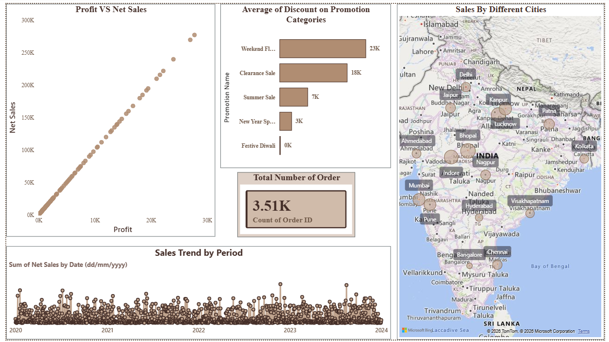
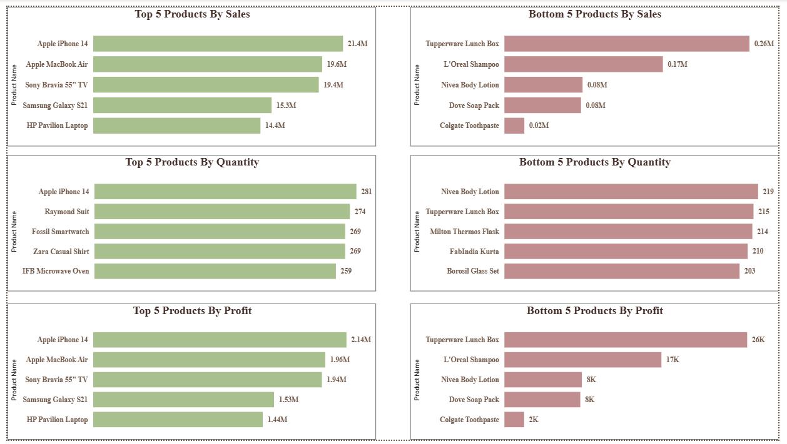
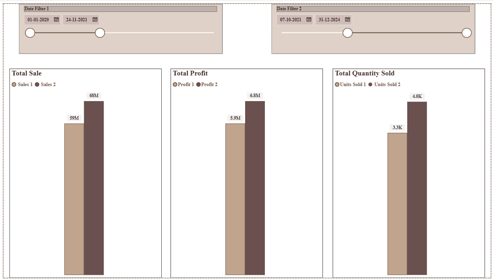
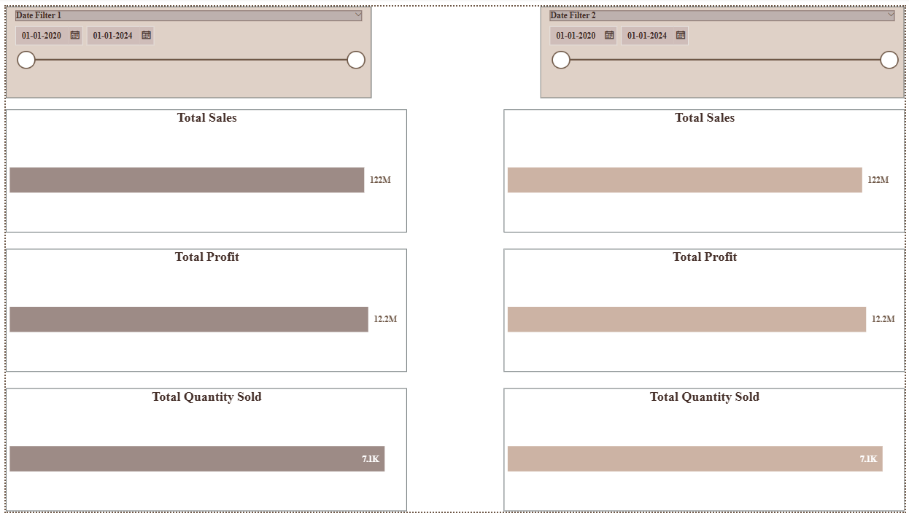
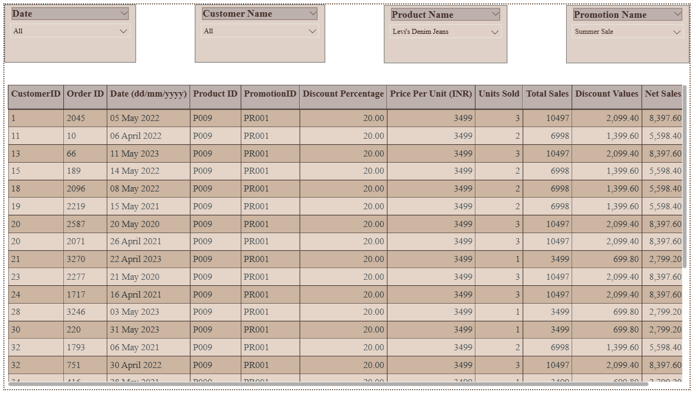

# 📊 Retail Sales Performance Dashboard | Power BI & Excel


An interactive retail sales analytics project built using Microsoft Power BI and Excel to analyze sales performance, profitability, product performance, and changes across different time periods. The dashboard includes sales trend analysis, profit versus net sales comparison, top and bottom product rankings, and interactive period-comparison features to support data-driven business decisions.

---

## Table of Contents

- [About the Project](#about-the-project)
- [Technologies Used](#technologies-used)
- [Dataset](#dataset)
- [Project Objectives](#project-objectives)
- [Project Workflow](#project-workflow)
- [Power BI Dashboard](#power-bi-dashboard)
- [Key Findings](#key-findings)
- [Business Recommendations](#business-recommendations)
- [How to Run](#how-to-run)
- [Project Structure](#project-structure)
- [Future Improvements](#future-improvements)
- [Author](#author)

---

## About the Project

The objective of this project is to analyze retail sales data and develop an interactive Power BI dashboard that helps users understand sales performance, profitability, product contribution, and changes over time.

The dashboard presents multiple analytical views, including sales trends by period, profit versus net sales, top and bottom five products by sales, quantity and profit, and comparisons between selected time periods.

Power BI is used to transform the source data into an interactive reporting experience. Visualizations and slicers allow users to explore different aspects of performance and compare results across selected periods and fields.

This project demonstrates practical skills in business intelligence, data visualization, KPI reporting, product performance analysis, and business-focused data storytelling.

---

## Technologies Used

- **Microsoft Power BI Desktop** — dashboard development, interactive visualizations, and report design.
- **Microsoft Excel** — source dataset storage and data inspection.
- **Power Query** — data import and transformation, where applicable in the report workflow.
- **DAX (Data Analysis Expressions)** — measures and calculations, where implemented in the report.
- **Power BI Slicers** — interactive filtering and period selection.

---

## Dataset

The project uses `Store+Data.xlsx` as its source dataset.

The dataset supports analysis of retail sales, profit, product performance, quantity sold, and time-based performance comparisons.

### Analytical Dimensions

| Dimension | Purpose |
|---|---|
| Sales | Analyze sales performance across products and periods. |
| Profit | Evaluate profitability and compare profit with sales. |
| Quantity | Examine product quantities sold. |
| Products | Identify top- and bottom-performing products. |
| Time Period | Analyze sales trends and compare selected periods. |
| Customer and Other Available Fields | Explore additional breakdowns using available report filters. |

**Data note:** The exact record count, date range, column definitions, and data-cleaning operations should be documented after verifying the source workbook. These details are not assumed here.

---

## Project Objectives

- Analyze overall retail sales and profit performance.
- Examine sales trends across different time periods.
- Compare profit and net sales to understand their relationship.
- Identify the top five and bottom five products by sales.
- Rank products by quantity sold and profit.
- Compare sales, profit, and quantity between selected periods.
- Develop interactive filters for exploring different fields.
- Present business performance through clear and informative visualizations.

---

## Project Workflow

1. **Data Import:** Used the Excel source dataset as the foundation for the Power BI report.
2. **Data Exploration:** Examined the available fields and identified relevant dimensions for sales and product analysis.
3. **Data Preparation:** Prepared the source data for reporting, with any cleaning and transformation steps to be documented according to the actual implementation.
4. **Report Development:** Created visualizations for sales trends, profit comparisons, and product rankings.
5. **Period Comparison:** Developed report pages for comparing selected periods using interactive controls.
6. **Interactive Filtering:** Added slicers to allow users to explore the report using different fields.
7. **Business Analysis:** Used the dashboard's analytical views to investigate performance differences and potential areas for improvement.

---

## Power BI Dashboard

The Power BI report contains multiple pages, each designed for a different analytical purpose.

### 1. Sales Overview

Provides an overview of sales performance through sales trends by period, profit versus net sales, and additional report visuals.

**Analytical focus:**
- Examine changes in sales over time.
- Compare profit and net sales.
- Explore product and other available breakdowns.

### 2. Top / Bottom 5 Products Analysis

Evaluates product performance through rankings based on sales, quantity sold, and profit.

**Analytical focus:**
- Identify the top five products by sales.
- Identify the bottom five products by sales.
- Compare the top and bottom five products by quantity.
- Examine the top and bottom five products by profit.

### 3. Approach 1 – Compare Values Between Any Two Periods

Provides a period-comparison view with selection controls and visual comparisons of business metrics.

**Analytical focus:**
- Compare performance across selected periods.
- Examine differences in total profit.
- Compare total quantity sold.
- Identify changes in the selected measures.

### 4. Approach 2 – Compare Values Between Any Two Periods

Provides an alternative visual approach to period comparison, including additional product-level and sales-related comparisons.

**Analytical focus:**
- Compare sales and profit across selected periods.
- Examine product-level performance differences.
- Investigate changes in selected metrics.

### 5. Slicer for Different Fields

Provides an interactive filtering view with slicers for exploring the available report dimensions.

**Analytical focus:**
- Filter the report using available fields.
- Narrow the analysis to selected products, customers, or other supported dimensions.
- Explore changes in the displayed results after applying filters.

### Dashboard Screenshots

Create a `screenshots/` folder in the repository and add screenshots captured from your actual Power BI report.

Use the following filenames or replace them with your preferred names:

#### Sales Overview



#### Top and Bottom 5 Products Analysis



#### Period Comparison – Approach 1



#### Period Comparison – Approach 2



#### Interactive Slicers



**Note:** These image references are placeholders. Add the actual screenshots to the repository using the corresponding filenames. GitHub will display them once the files are committed.

---

## Key Findings

The dashboard is designed to support the following business questions:

- Which products generate the highest sales?
- Which products have the lowest sales performance?
- Which products contribute the most to total profit?
- How do sales and profit change across selected periods?
- How does quantity sold vary between products and periods?
- How does profit compare with net sales?
- How do the results change when different report filters are applied?

**Important:** Actual findings should be added after reviewing the dashboard results. Avoid stating that a particular product, period, or category performs best until the corresponding values have been verified.

---

## Business Recommendations

The dashboard can support the following potential business actions, depending on the results observed:

- **Product performance:** Review high-performing products to understand their contribution to sales and profitability.
- **Underperforming products:** Investigate products with consistently low sales or profit to identify possible improvement opportunities.
- **Profitability monitoring:** Compare profit with sales to identify products that generate revenue but contribute less profit.
- **Period-based planning:** Use period comparisons to investigate changes in business performance and support planning.
- **Inventory planning:** Consider quantity sold alongside sales performance when evaluating product demand.
- **Performance monitoring:** Use interactive reporting to investigate changes in selected metrics and identify areas requiring further analysis.

These are potential recommendations. Final business actions should be based on verified findings and relevant operational context.

---

## How to Run

### 1. Clone the Repository

```bash
git clone https://github.com/HaravdeAakanksha/Retail-Sales-Performance-Dashboard-.git
```

Alternatively, open the repository on GitHub and download it as a ZIP file.

### 2. Open the Power BI Report

Open `Project-1.pbix` using Microsoft Power BI Desktop.

### 3. Check the Data Source

The repository contains `Store+Data.xlsx`, which is the source dataset.

If Power BI prompts you to reconnect to the source file:

1. Locate `Store+Data.xlsx`.
2. Update the data source path if required.
3. Verify that the relevant sheets, tables, and columns are available.
4. Refresh the report and check that the visuals load correctly.

### 4. Explore the Dashboard

Navigate through the report pages and use the available slicers and selection controls to explore sales trends, product rankings, profit performance, and period comparisons.

### 5. Add Screenshots to GitHub

1. Open the report in Power BI Desktop.
2. Navigate to a report page.
3. Capture a clear screenshot of the complete page.
4. Save the image in the `screenshots/` folder.
5. Ensure the filenames match the image references in this README.
6. Commit and push the README and screenshot files to GitHub.

---

## Project Structure

```text
Retail-Sales-Performance-Dashboard-/
│
├── README.md
├── Project-1.pbix
├── Store+Data.xlsx
│
└── screenshots/
    ├── sales-overview.png
    ├── top-bottom-products.png
    ├── period-comparison-approach-1.png
    ├── period-comparison-approach-2.png
    └── interactive-slicers.png
```

The `screenshots/` directory and its image files are to be added to the repository.

---

## Future Improvements

- Document the source dataset's row count, date range, and data-quality checks.
- Add a dedicated data dictionary describing the source columns.
- Document the DAX measures and calculated fields used in the report.
- Add verified numerical findings and business recommendations.
- Improve report navigation and visual consistency across pages.
- Add clearly defined KPIs and percentage-change calculations where appropriate.
- Include additional time-intelligence measures for month-over-month and year-over-year analysis, if supported by the data.
- Publish the dashboard to Power BI Service if online sharing is required.

---

## Author

**Aakanksha Haravde**

Aspiring Data Analyst | Power BI | Excel | Data Analytics | Business Intelligence
